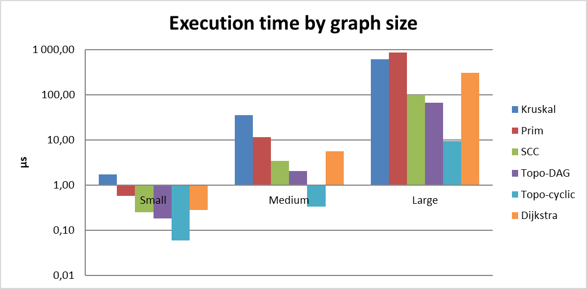
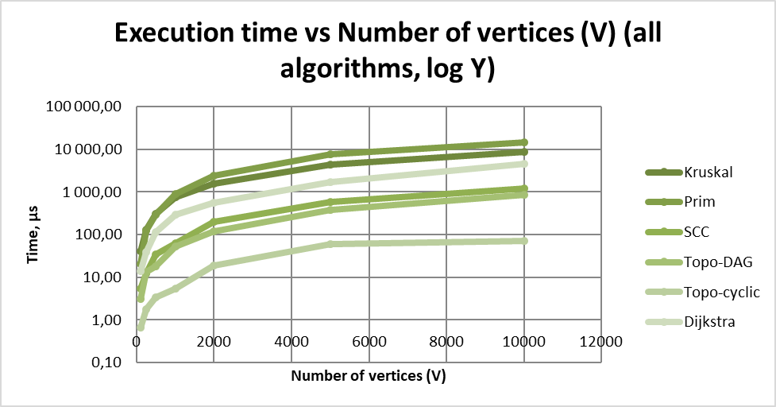
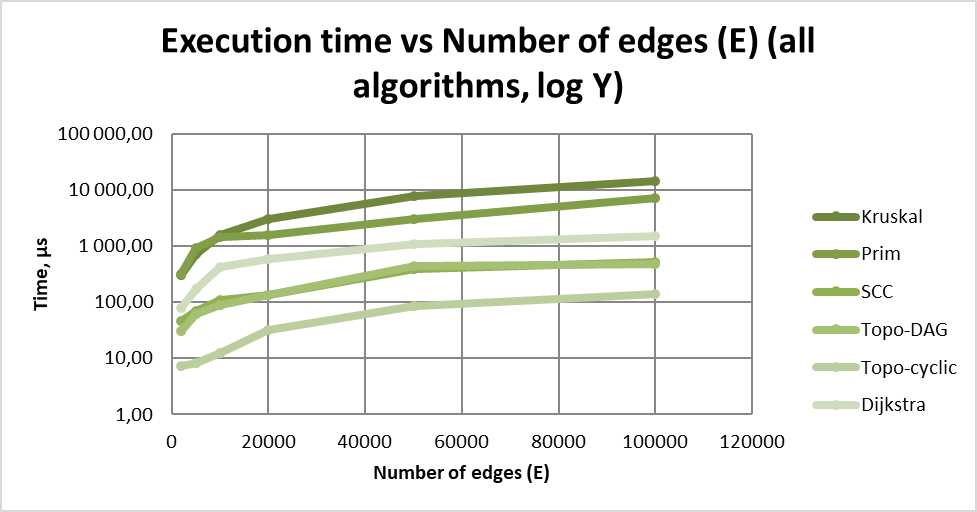
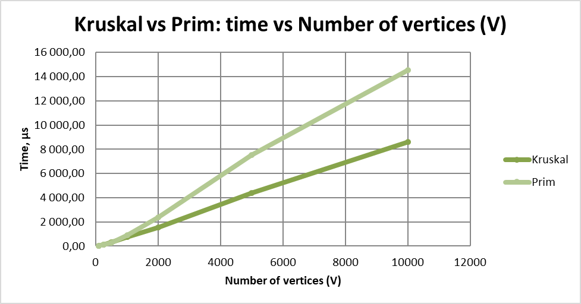
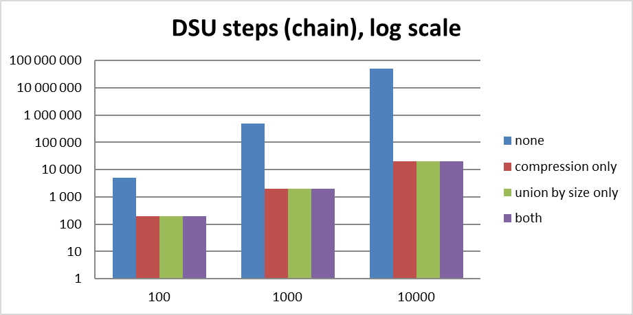
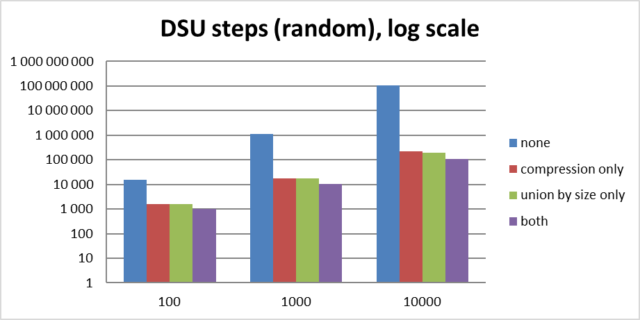

# Assignment 3
### Group: SE-2539
### Full name: Aktanbi Kusman
### Course: Design and analysis of algorithms

# Smart City Infrastructure and Route Planning

## 1. Overview

This project models a smart city as a graph and provides algorithms for three planning tasks:

| Task | Question | Algorithms |
|---|---|---|
| 1. Infrastructure planning | What is the cheapest network that connects all districts? | Kruskal (with DSU), Prim (with priority queue) |
| 2. Connectivity analysis | Which districts depend on each other? Is there a valid build order? | Topological ordering (Kahn), strongly connected components (Tarjan) |
| 3. Route planning | What is the shortest route from a chosen district to every other? | Dijkstra |

**Graph model**

- **Vertices:** city districts, numbered `0 … V-1`.
- **Edges:** roads or infrastructure connections (undirected for MST, directed for connectivity and routing).
- **Weights:** non-negative integers: construction cost (Task 1) or travel distance (Task 3).

**Representation: adjacency list.** Every vertex keeps a list of its outgoing edges, so memory use is O(V + E) and iterating over the neighbours of a vertex costs only its degree. An adjacency matrix would need O(V²) memory, which is wasteful for the sparse graphs used here (E ≈ 5V). In addition, the graph keeps a flat list of all edges, which Kruskal needs for sorting.

## 2. Project structure

```
assignment-3/
├── src/
│   ├── graph/          Edge, Graph, GraphGenerator
│   ├── dsu/            DisjointSet, ConfigurableDSU (experiment only)
│   ├── mst/            MSTResult, Kruskal, Prim
│   ├── connectivity/   TopoResult, TopologicalSort, SCCResult, TarjanSCC
│   ├── shortestpath/   DijkstraResult, Dijkstra
│   ├── benchmark/      Benchmark (all experiments, writes CSV/Markdown tables)
│   └── tests/          TestRunner (55 correctness checks, no external libraries)
├── scripts/plot.py     builds the plots from the CSV tables
├── results/
│   ├── tables/         CSV and Markdown tables with the measurements
│   └── plots/          PNG plots
└── README.md
```

## 3. How to build and run

Requires JDK 11 or newer (the code uses `List.of`) and, for the plots only, Python 3 with `matplotlib`.

```
javac -d out $(find src -name "*.java")     # compile
java -cp out tests.TestRunner               # run all correctness checks
java -cp out benchmark.Benchmark results    # run all experiments (about 1-2 minutes)
python3 scripts/plot.py results             # build plots
```

On Windows PowerShell, compile with
`javac -d out (Get-ChildItem -Recurse src -Filter *.java).FullName`.

Everything is reproducible: all random graphs use the fixed seed `42` (see section 6).

## 4. Implementation

### 4.1 `Edge` and `Graph` (package `graph`)

`Edge` is immutable (`from`, `to`, `weight`, all `final`) and implements `Comparable<Edge>` by weight, so Kruskal can sort edges directly.

`Graph` supports both directed and undirected mode. In undirected mode an edge is stored twice in the adjacency lists (`u→v` and `v→u`) but once in the flat edge list, so Kruskal does not see each road twice.

Vertex indices are validated; a graph must have at least one vertex. Negative weights are not rejected by `Graph` itself; Dijkstra rejects them (see section 5.6).

### 4.2 Disjoint Set Union (package `dsu`)

`DisjointSet` keeps two arrays: `parent` (the parent of each element, a root points to itself) and `size` (the size of each tree, used only for roots).

`find` uses **path compression**: after finding the root, every element on the path is pointed directly at it. It is written iteratively to avoid stack overflow on long chains.

`union` uses **union by size**: the smaller tree is attached under the larger one. It returns `true` only if two different sets were actually merged.

The class also counts components (starts at n, decreases on every successful merge) and three operation counters for the experiments: find calls, union calls and parent-pointer steps. Every `union` calls `find` twice, and those calls are included in the find counter.

`ConfigurableDSU` is a copy of the same structure with the two optimizations switchable. It is used only in the DSU experiment (section 8.3) and never by Kruskal.

### 4.3 Kruskal (package `mst`)

Kruskal sorts a copy of the edge list by weight (the graph itself is not modified, so the algorithm can be repeated on the same graph) and goes through it with a `DisjointSet`. An edge is kept only if `union` merges two different components. The algorithm stops as soon as n-1 edges are chosen. If fewer than n-1 edges were chosen, the graph is disconnected and the result is a spanning forest (`connected = false`).

Results are returned in `MSTResult`: chosen edges, total weight, connectivity flag and operation counters (edge examinations, sort comparisons, DSU operations).

### 4.4 Prim (package `mst`)

Prim grows one tree from a start vertex. A `PriorityQueue` holds the edges leaving the tree; the cheapest edge is taken, and edges leading to an already visited vertex are skipped (lazy version, no decrease-key). If the graph is disconnected, Prim restarts from the next unvisited vertex, so the result is a spanning forest with the same total weight as Kruskal's.

Prim returns the same `MSTResult` as Kruskal. Edge examinations count all edges looked at while scanning neighbours, comparisons are counted inside the priority queue comparator, and DSU operations are 0.

### 4.5 Topological ordering (package `connectivity`)

Topological ordering uses Kahn's algorithm. In-degrees of all vertices are computed first; vertices with in-degree 0 go into a queue. Each removed vertex is added to the order and decreases the in-degree of its neighbours. If the final order contains fewer than V vertices, the graph has a cycle and no topological order exists (`isDag = false`). In that case the returned list contains only the vertices that could be processed.

`TopologicalSort.isValidOrder` checks a result: every vertex appears exactly once and for every edge `u -> v`, `u` comes before `v`. It is used in the tests and in the benchmark.

### 4.6 Strongly connected components (package `connectivity`)

SCC uses Tarjan's algorithm: one depth-first search with a discovery number (`disc`) and a low-link value (`low`) for every vertex, plus a stack of vertices that are still open. When `low[v] == disc[v]`, `v` is the root of a component and everything above it on the stack is popped as one SCC. The search is started from every unvisited vertex, so disconnected parts of the graph are handled too. Every vertex ends up in exactly one component.

The DFS is recursive, which is safe for graphs of the sizes required here (up to 1,000 vertices). The benchmark runs in a thread with a large stack so that the larger scaling tests (10,000 vertices) also work; for much larger graphs the DFS would need to be rewritten iteratively.

### 4.7 Dijkstra (package `shortestpath`)

Dijkstra uses a binary-heap `PriorityQueue` of `{distance, vertex}` pairs with lazy deletion (outdated entries are skipped when polled). It keeps a distance array and a parent array. `DijkstraResult` reports distances, reconstructs paths (`getPath`), and marks unreachable vertices with `Long.MAX_VALUE` (`isReachable` is `false`, the path is empty). The algorithm throws `IllegalArgumentException` if any edge weight is negative.

### 4.8 Graph generator (package `graph`)

`GraphGenerator` produces reproducible graphs (same seed, same graph); weights are random integers in `[1, 100]`, with no self-loops and no duplicate edges. See section 6.

## 5. Complexity Analysis

Notation: V = number of vertices, E = number of edges. Unless stated otherwise: adjacency-list graph, binary heap for priority queues.

### 5.1 DSU

| Operation | Time | Space |
|---|---|---|
| `find` | amortized O(α(V)) | O(V) for the `parent` and `size` arrays |
| `union` | amortized O(α(V)) | |

α is the inverse Ackermann function; it does not exceed 4 for any practical input, so both operations are effectively constant time. Without the two optimizations, a bad sequence of unions builds a chain and `find` costs O(V).

**Why the optimizations help**

- **Union by size** attaches the smaller tree under the larger one, so the height of a tree grows only when two trees of equal size merge. The height stays O(log V).
- **Path compression** makes every node visited by `find` point directly at the root, so later `find` calls on those nodes take one step.
- Together they give the near-constant amortized cost. Section 8.3 measures this.

### 5.2 Kruskal

- Sorting E edges: O(E log E) = O(E log V) (since E ≤ V², log E ≤ 2 log V).
- At most E iterations, each with a DSU operation: O(E · α(V)).
- **Total: O(E log V)**, dominated by sorting. **Space: O(V + E)** (graph, edge list copy, DSU, result).
- More edges mean a more expensive sort; more vertices only add a very slowly growing DSU cost. Kruskal stops early once V-1 edges are accepted, but the sort has already been paid for.

### 5.3 Prim (binary heap, lazy version)

- Each edge enters the heap at most once per direction, so the heap holds O(E) entries; each insert or extract costs O(log E) = O(log V).
- **Total: O(E log V). Space: O(V + E).**
- With a heap that supports decrease-key the bound is O((V + E) log V), and with a Fibonacci heap O(E + V log V); neither is used here.
- Performance depends mainly on E: every edge is examined once from each endpoint. Heap work depends only on edges that lead to still unvisited vertices.

### 5.4 Topological ordering (Kahn)

- Every vertex is enqueued at most once and every edge is processed twice in total (once for the in-degree, once when its tail is removed).
- **Time: O(V + E). Space: O(V)** extra (in-degree array, queue, output).
- Cycle detection is a by-product: fewer than V vertices in the output means a cycle exists. On a cyclic graph the algorithm stops as soon as the queue runs empty, so it can finish much earlier than on a DAG.

### 5.5 SCC (Tarjan)

- One DFS: each vertex is visited once and each edge examined once.
- **Time: O(V + E).** **Space: O(V)** extra (`disc`, `low`, `onStack`, stack, recursion). Kosaraju's algorithm would additionally need the transposed graph, O(V + E).
- Runtime grows linearly with the size of the graph.

### 5.6 Dijkstra (binary heap)

- Each vertex is finalized once; each edge triggers at most one heap insertion (with lazy deletion the heap holds up to E entries).
- **Time: O((V + E) log V). Space: O(V + E).**
- On dense graphs E ≈ V², so the cost approaches O(V² log V).

**Why Dijkstra fails with negative edges.** Dijkstra's correctness rests on the invariant that once a vertex is removed from the heap, its distance is final, because any other path to it would have to pass through vertices that are at least as far away and could only add non-negative cost. A negative edge breaks this: a longer-looking path can later become shorter through a negative edge, but the vertex is already finalized and is never updated. Example: edges `A→B = 2`, `A→C = 5`, `C→B = -4`. Dijkstra finalizes `B` with distance 2, but the real shortest path is `A→C→B = 1`. For such graphs Bellman–Ford is needed. This is why `Dijkstra.run` rejects negative weights.

### 5.7 Summary

| Algorithm | Time | Extra space | Depends mainly on |
|---|---|---|---|
| DSU find / union | amortized O(α(V)) | O(V) | almost nothing (near constant) |
| Kruskal | O(E log V) | O(V + E) | E (sorting) |
| Prim (binary heap) | O(E log V) | O(V + E) | E (heap pushes) |
| Topological order (Kahn) | O(V + E) | O(V) | V + E |
| SCC (Tarjan) | O(V + E) | O(V) | V + E |
| Dijkstra (binary heap) | O((V + E) log V) | O(V + E) | E, with a log V factor |

## 6. Experimental Setup

**Graph sizes (required)**

| Graph | V | E |
|---|---|---|
| Small | 10 | 30 |
| Medium | 100 | 500 |
| Large | 1,000 | 5,000 |

**Graph generation.** `java.util.Random` with a fixed seed (`SEED = 42`; the three graph types use seeds 42, 43 and 44). The same code always produces the same graphs. Weights are random integers in `[1, 100]`. No self-loops, no duplicate edges.

- **Undirected graph for MST (always connected):** first a random spanning tree is built (each vertex `i ≥ 1` is linked to a random earlier vertex), then random extra edges are added until exactly E edges exist. The graph is therefore connected by construction (this is also checked by the tests).
- **Directed graph for SCC, topological ordering on cyclic graphs and Dijkstra:** E random directed edges. These graphs contain cycles: the SCC results below show components with many vertices (for example, the Large graph has one component with 987 of 1,000 vertices), and Kahn's algorithm reports a cycle on all three.
- **Directed acyclic graph for topological ordering on DAGs:** a random vertex order is chosen and every edge goes from an earlier to a later vertex in that order, so a cycle is impossible. The produced orders are verified with `isValidOrder`.
- **Dijkstra** runs from vertex 0 on the directed random graph.

**Measurement procedure**

- Time is measured with `System.nanoTime()`, graph generation is excluded.
- Each algorithm is **repeated 5 times** per graph and the average is reported (in microseconds, per single run).
- Before measuring, each task is **warmed up** (at least 30 runs and at least 0.3 s) so the JIT compiler is finished. Very fast tasks (a few microseconds) are run several times inside each of the 5 repeats and the repeat time is divided by the number of inner runs; otherwise a single run would be below the resolution of the timer and below the noise of the garbage collector.
- Counted operations: **edge examinations** (edges looked at), **comparisons** (inside the sort for Kruskal, inside the priority queue for Prim and Dijkstra), **DSU operations** (find calls + union calls). Operation counts are deterministic and do not change between runs.
- Measured on: **TODO — write your CPU, RAM and JDK version here after running the benchmark on your computer.** Absolute times depend on the hardware; operation counts and growth trends do not.

**Additional experiments** (not required, used to get better plots and to explain the results):

- *Scaling in V:* V = 100 … 10,000 with E = 5V.
- *Scaling in E:* V = 1,000 fixed, E = 2,000 … 100,000.
- *DSU experiment:* parent-pointer steps with and without each optimization.

## 7. Results

All tables are produced by `benchmark.Benchmark` and stored in `results/tables/`.

### 7.1 Required sizes: all algorithms

(`results/tables/required_sizes.csv`; time in microseconds per run)

| Graph | V | E | Algorithm | Avg time (µs) | Edge examinations | Comparisons | DSU ops | Result |
|---|---|---|---|---|---|---|---|---|
| Small | 10 | 30 | Kruskal | 0.59 | 14 | 107 | 42 | weight=129, connected |
| Small | 10 | 30 | Prim | 2.12 | 56 | 144 | 0 | weight=129, connected |
| Small | 10 | 30 | SCC | 0.81 | 30 | 0 | 0 | 3 components, largest 8 |
| Small | 10 | 30 | Topo-DAG | 0.20 | 60 | 0 | 0 | DAG, order valid |
| Small | 10 | 30 | Topo-cyclic | 1.48 | 35 | 0 | 0 | cycle, ordered 1/10 |
| Small | 10 | 30 | Dijkstra | 1.46 | 25 | 18 | 0 | 9 reachable, 8 relaxations |
| Medium | 100 | 500 | Kruskal | 39.90 | 164 | 3827 | 492 | weight=1170, connected |
| Medium | 100 | 500 | Prim | 15.45 | 993 | 3742 | 0 | weight=1170, connected |
| Medium | 100 | 500 | SCC | 5.04 | 500 | 0 | 0 | 4 components, largest 97 |
| Medium | 100 | 500 | Topo-DAG | 2.84 | 1000 | 0 | 0 | DAG, order valid |
| Medium | 100 | 500 | Topo-cyclic | 1.16 | 515 | 0 | 0 | cycle, ordered 2/100 |
| Medium | 100 | 500 | Dijkstra | 16.99 | 485 | 1439 | 0 | 98 reachable, 141 relaxations |
| Large | 1000 | 5000 | Kruskal | 522.48 | 3356 | 50369 | 10068 | weight=13123, connected |
| Large | 1000 | 5000 | Prim | 658.34 | 9997 | 85148 | 0 | weight=13123, connected |
| Large | 1000 | 5000 | SCC | 69.00 | 5000 | 0 | 0 | 14 components, largest 987 |
| Large | 1000 | 5000 | Topo-DAG | 55.01 | 10000 | 0 | 0 | DAG, order valid |
| Large | 1000 | 5000 | Topo-cyclic | 7.16 | 5031 | 0 | 0 | cycle, ordered 8/1000 |
| Large | 1000 | 5000 | Dijkstra | 253.17 | 4969 | 23478 | 0 | 992 reachable, 1410 relaxations |

Kruskal and Prim return the same total weight on every graph (129, 1170, 13123). Times for the Small graph are between 0.2 and 2.1 microseconds, which is close to the limit of what `System.nanoTime()` can resolve; differences between algorithms on that graph (for example Topo-DAG vs Topo-cyclic) are noise and should not be interpreted.

### 7.2 Scaling in V (E = 5V)

(`results/tables/scaling_vertices.csv`)

| V | E | Kruskal (µs) | Prim (µs) | SCC (µs) | Topo-DAG (µs) | Dijkstra (µs) |
|---|---|---|---|---|---|---|
| 100 | 500 | 35.59 | 16.41 | 6.01 | 4.24 | 11.57 |
| 250 | 1,250 | 81.56 | 98.41 | 16.98 | 10.01 | 30.92 |
| 500 | 2,500 | 227.09 | 210.32 | 32.34 | 21.47 | 76.07 |
| 1,000 | 5,000 | 514.77 | 619.71 | 74.80 | 46.56 | 236.30 |
| 2,000 | 10,000 | 1323.84 | 1726.18 | 174.99 | 105.61 | 694.52 |
| 5,000 | 25,000 | 3049.89 | 5679.36 | 674.39 | 373.11 | 2403.77 |
| 10,000 | 50,000 | 6711.93 | 11607.66 | 1935.65 | 1043.12 | 5680.55 |

### 7.3 Scaling in E (V = 1,000)

(`results/tables/scaling_edges.csv`)

| E | Kruskal (µs) | Kruskal comparisons | Prim (µs) | Prim comparisons | SCC (µs) | Topo-DAG (µs) | Dijkstra (µs) |
|---|---|---|---|---|---|---|---|
| 2,000 | 205.94 | 18,823 | 225.52 | 39,489 | 51.86 | 27.06 | 80.75 |
| 5,000 | 559.04 | 50,369 | 597.39 | 85,148 | 68.20 | 46.56 | 263.19 |
| 10,000 | 1052.17 | 103,055 | 967.74 | 121,849 | 106.57 | 73.37 | 415.48 |
| 20,000 | 2043.81 | 209,098 | 1494.16 | 138,188 | 180.69 | 117.53 | 616.56 |
| 50,000 | 5276.22 | 527,830 | 3190.93 | 228,040 | 413.69 | 398.28 | 1166.87 |
| 100,000 | 10815.02 | 1,058,747 | 7505.50 | 341,455 | 1657.05 | 1042.47 | 2152.15 |

### 7.4 DSU experiment

(`results/tables/dsu_experiment.csv`; steps = parent-pointer hops)

Scenario **chain**: `union(1,0), union(2,1), union(3,2), …`, then `find` on every element. This is the worst case for a DSU without optimizations. Scenario **random**: 5n random unions, then `find` on every element.

| Scenario | n | No optimization | Compression only | Union by size only | Both |
|---|---|---|---|---|---|
| chain | 100 | 4,950 | 197 | 196 | 196 |
| chain | 1,000 | 499,500 | 1,997 | 1,996 | 1,996 |
| chain | 10,000 | 49,995,000 | 19,997 | 19,996 | 19,996 |
| random | 100 | 15,472 | 1,577 | 1,631 | 1,019 |
| random | 1,000 | 1,127,741 | 17,330 | 17,923 | 10,443 |
| random | 10,000 | 107,555,300 | 220,715 | 192,266 | 105,021 |

### 7.5 Plots

Required plots (Small / Medium / Large, log-log axes):



Additional plots:












## 8. Comparison and Discussion

### 8.1 Kruskal vs. Prim

Both algorithms always found the same MST weight, as required (129 / 1170 / 13123), but they do their work differently:

- **Edge examinations.** Prim looks at about 2E adjacency entries (every edge from both ends): 56, 993, 9,997. Kruskal sorts all E edges but then examines only the prefix of the sorted list that it needs: 14, 164, 3,356 (it stops after V-1 accepted edges).
- **Comparisons.** On the sparse graphs (E = 5V) Prim needs more comparisons in the large cases (85,148 vs 50,369 on Large, 1.35 million vs 0.53 million at V = 10,000). Each heap insertion and extraction costs about log E comparisons, and Prim pushes up to one entry per edge into the heap, while Kruskal's sort is one tight pass of about E log E comparisons.
- **Time.** On the Large graph the two are close (522 µs vs 658 µs). With E = 5V, Kruskal was faster for V ≥ 1,000 and about 1.7 times faster at V = 10,000. In the E-scaling experiment (V = 1,000) the picture changes: for small E they are equal, and as the graph gets denser Prim wins (at E = 100,000: 7.5 ms vs 10.8 ms). Kruskal's comparison count grows in proportion to E log E (18,823 → 1,058,747), but Prim's grows much more slowly (39,489 → 341,455), because in a dense graph most edges lead to already visited vertices and never enter the heap.
- **Conclusion for this data:** neither is always faster. Kruskal is better for sparse graphs and edge lists; Prim is better when the graph is dense. The Small and Medium timings are too short to separate them reliably.

### 8.2 Theory vs. experiment

- **Kruskal, O(E log V).** From V = 100 to V = 10,000 (E = 5V) the work grows by a factor of 100 in E and 2 in log V, so about 200×. The measured time grew by 189× (35.6 → 6,712 µs). In the E-scaling test, E grew by 50 and the time by 52 (206 → 10,815 µs). This matches the theory well.
- **Prim, O(E log V).** The time grew 707× over the V range (16.4 → 11,608 µs), noticeably more than the predicted ~200×. Edge examinations grow in proportion to E (about 2E), and comparisons grew 360× (3,742 → 1,347,123), so the heap does more than the simple E log V estimate suggests (a larger heap also likely means worse memory locality). In the E-scaling test Prim grew only 33× for a 50× increase in E, better than linear, for the reason given in 8.1.
- **SCC and topological ordering, O(V + E).** The operation counts are exactly linear: Tarjan examines exactly E edges (500 → 50,000) and Kahn exactly 2E. The measured time grew 322× (SCC) and 246× (Topo-DAG) for a 100× growth of V + E, i.e. somewhat more than linear. Since the amount of work is exactly linear, the extra growth is most likely caused by memory effects (the graph is a structure of many small objects, and larger graphs no longer fit in the processor cache), not by extra operations. In the E-scaling test SCC grows from 52 to 1,657 µs, and the last step (50,000 → 100,000 edges) is more than linear, which also points to cache effects.
- **Dijkstra, O((V + E) log V).** Time grew 491× over the V range (11.6 → 5,681 µs) and comparisons 232×. Edge examinations are bounded by E (49,609 at V = 10,000) and the number of relaxations is much smaller than E (1,410 of 4,969 on Large). Heap comparisons depend mostly on the number of relaxations, which is why they grow much more slowly than E in the E-scaling test (10,263 → 80,134 for a 50× larger E).

### 8.3 DSU: effect of path compression and union by size

The steps table (7.4) shows the effect directly.

- **No optimization:** on the chain with n = 10,000, `find` walks 49,995,000 steps in total (about n²/2), and on random unions 107,555,300 steps. Time per run was about 115 ms and 250 ms.
- **Either optimization alone** reduces the steps by a factor of roughly 500 to 2,500: on the chain 19,996–19,997 steps (about 2n) and on random unions 192,266–220,715.
- **Both together** are best on random unions: 105,021 steps for 110,000 `find` calls, i.e. less than one pointer hop per `find` on average. On the chain, each optimization alone already reaches the minimum.
- **Why:** union by size keeps trees shallow in the first place (height O(log n)); path compression repairs depth that has already appeared, so later finds are almost free. The combination gives the almost constant amortized cost O(α(n)).

### 8.4 SCC: runtime growth

With E = 5V the SCC runtime grew from 6 µs (V = 100) to 1.9 ms (V = 10,000). Operation counts grow exactly with E, so the algorithm is linear in the size of the graph; the measured growth is slightly steeper than linear because of memory effects (see 8.2). Random directed graphs of this density have a giant strongly connected component (for example 987 of 1,000 vertices on Large), so most vertices end up in a single component and the number of components stays small (3, 4 and 14).

### 8.5 Topological ordering: DAGs vs. cyclic graphs

- On **DAGs** Kahn's algorithm always orders all vertices; every produced order passed `isValidOrder`. It examines exactly 2E edges.
- On **cyclic** graphs it correctly reports `isDag = false`. It stops as soon as no vertex has in-degree 0; because the random directed graphs have a giant strongly connected component, it ordered only 1 of 10, 2 of 100 and 8 of 1,000 vertices and did little work (5,031 edge examinations instead of 10,000 on Large, and 7 µs instead of 55 µs). Detecting a cycle is therefore cheaper than ordering a DAG of the same size, at least for such graphs.

### 8.6 Dijkstra

Edge examinations are bounded by E (25 → 485 → 4,969 across the three sizes), and the unreachable vertices (1, 2 and 8 of the three graphs) are never expanded. The measured time grows from 1.5 µs to 253 µs between Small and Large. The heap comparison count (18 → 1,439 → 23,478) grows faster than V but slower than E log V because only successful relaxations insert entries.

### 8.7 Limitations of the measurements

- The Small graphs run in about a microsecond, close to the timer resolution; their times are shown for completeness only.
- Times depend on the JIT compiler and the garbage collector; the warm-up and repeated runs reduce but do not remove this noise. Operation counts are exact and reproducible.
- Each size is a single random graph per type (fixed seed), not an average over many graphs.

## 9. Testing

All tests are in `src/tests/TestRunner.java` and use plain Java (no external libraries). Run with `java -cp out tests.TestRunner`. **Result: 55 checks, 55 passed, 0 failed.**

| Required case | How it is tested |
|---|---|
| Small graphs | The example graph from the lecture (9 vertices, 14 edges): both algorithms give weight 37 with 8 edges, Kruskal examines exactly 11 edges, as in the lecture. Hand-made graphs for topological order, SCC and Dijkstra with distances and paths computed by hand |
| Disconnected graphs | 5 vertices in three components: Kruskal and Prim both report `connected = false` and the same forest weight (8) |
| Graphs containing cycles | Kahn reports `isDag = false` and returns a partial order; Tarjan finds two components `{0,1,2}` and `{3,4,5}`; a DAG gives one component per vertex |
| Multiple valid MSTs | A triangle with equal weights (3 valid trees): both algorithms return weight 2 |
| Unreachable vertices | Dijkstra marks them as unreachable, returns an empty path and the right reachable count |
| Duplicate edge weights | A 2×3 grid with all weights equal to 5: MST weight 25 for both |
| Single vertex | MST weight 0 and connected; topological order `[0]`; one SCC; Dijkstra distance 0 |
| Invalid input | Dijkstra rejects a negative weight and a bad source; Kruskal and Prim reject directed graphs; Kahn and Tarjan reject undirected graphs; DSU rejects size 0 |

**Randomized correctness checks**

- Kruskal and Prim return the **same MST weight** on 100 random connected graphs of five different sizes, and both use exactly V-1 edges.
- Every topological order of 50 random **DAGs** is valid (`isValidOrder`); on 50 random directed graphs, cycle detection by Kahn agrees with Tarjan (a graph is a DAG exactly when every component has size 1).
- In 50 random directed graphs **every vertex belongs to exactly one SCC** (component sizes sum to V, no vertex repeats, all `componentId` values are valid).
- Dijkstra's distances equal the distances of an independent **Bellman–Ford** implementation on 60 random graphs (directed and undirected, non-negative weights).
- The generator gives the same graph for the same seed, and the generated undirected graph is connected.

## 10. Conclusion

- **Network planning (MST).** Kruskal and Prim always agree on the minimum cost. Kruskal with a DSU is simple and fast on sparse graphs and when the input is an edge list; Prim with a heap is the better choice for dense graphs and when the graph is stored as adjacency lists. The DSU optimizations are essential: without them the same work took up to about 2,500 times more steps.
- **Dependencies and connectivity.** Kahn's algorithm gives a build order for acyclic dependencies and detects a cycle in O(V + E); Tarjan's algorithm finds the groups of mutually dependent districts or services in one pass. Both scale linearly in the size of the graph.
- **Routing.** Dijkstra with a binary heap gives all shortest distances and paths from one district in O((V + E) log V) and handles unreachable districts. It requires non-negative weights; for graphs with negative weights Bellman–Ford has to be used instead.
- **Theory and practice.** The measured operation counts follow the theoretical bounds exactly (linear for SCC and Kahn, E log E for Kruskal's sort). Measured times follow the same trends, with some extra growth for large graphs that is most likely caused by memory effects rather than extra work.
